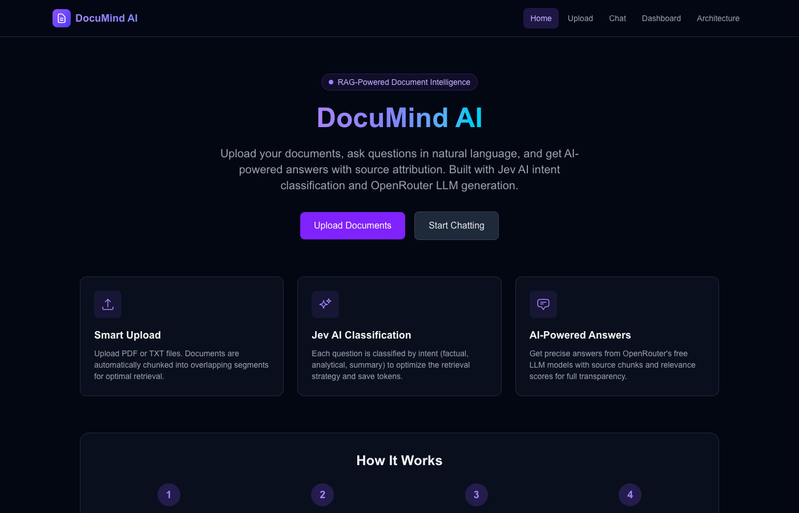
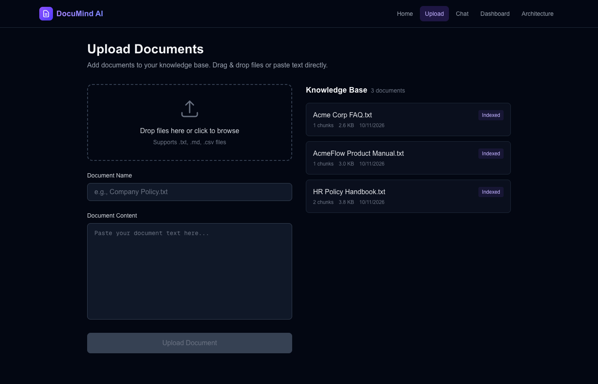
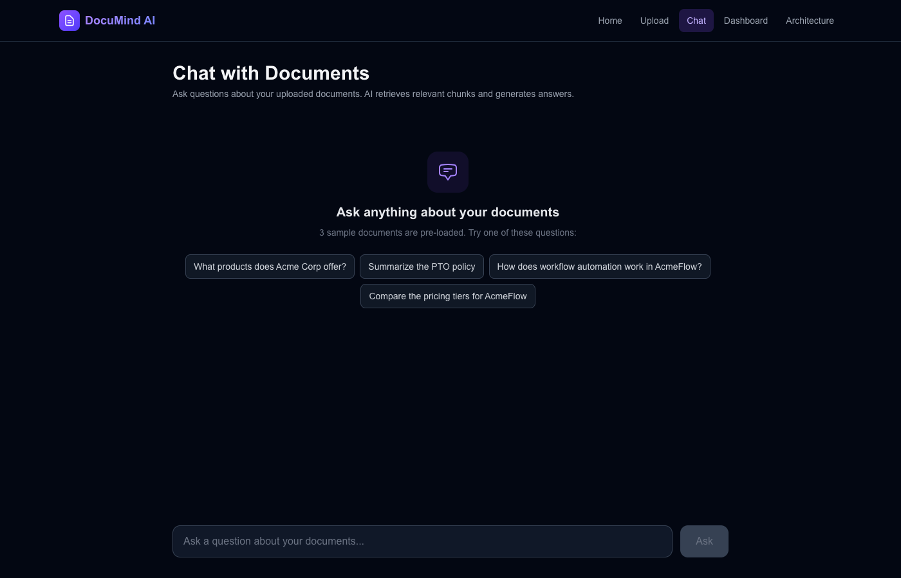
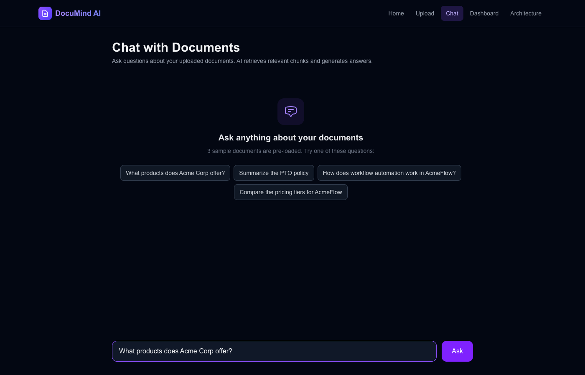
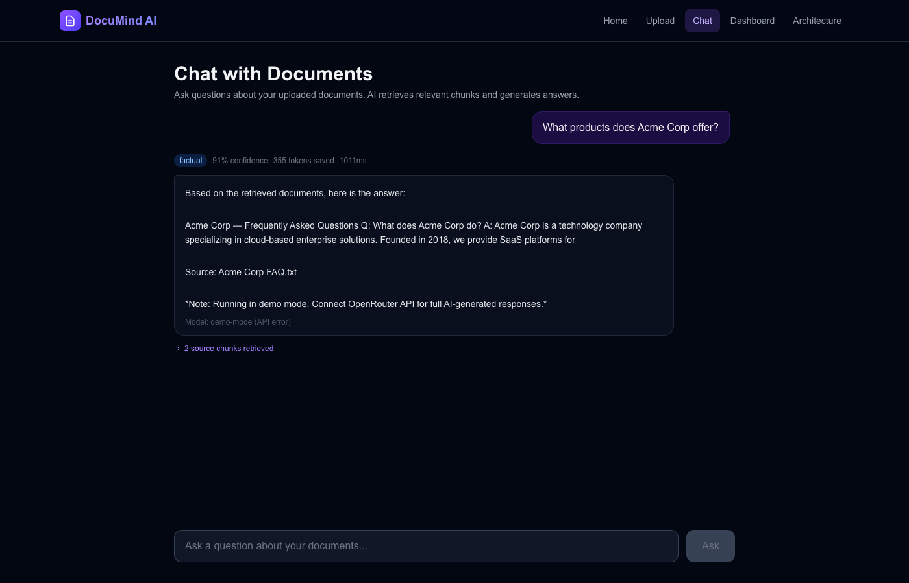
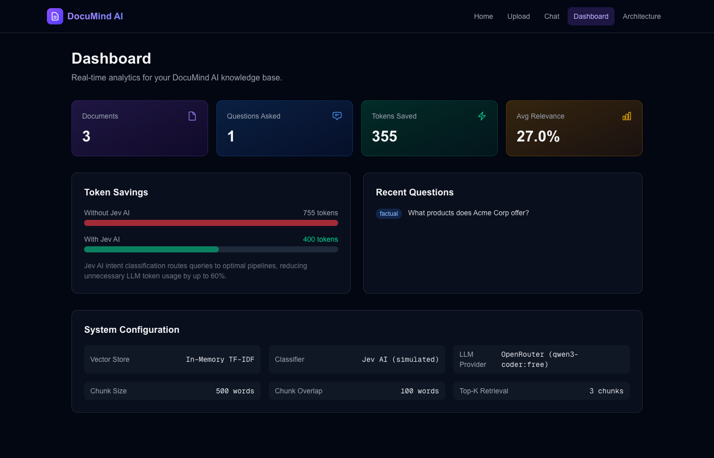
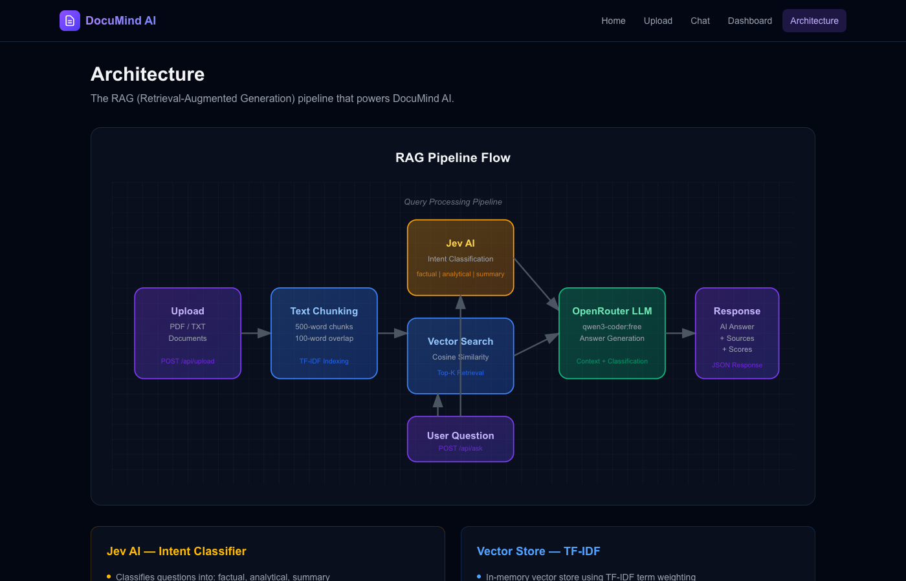

# DocuMind AI — RAG Document Q&A Platform

> Upload documents, ask questions in natural language, and get AI-powered answers with source attribution and relevance scoring.

**Live Demo**: Works out of the box in demo mode — no API keys required.

---

## Screenshots

### Landing Page


### Document Upload & Knowledge Base


### Chat — Ask Questions



### Chat — AI Answer with Source Attribution


### Analytics Dashboard


### RAG Pipeline Architecture


---

## What It Does

DocuMind AI is a Retrieval-Augmented Generation (RAG) platform that lets users:

1. **Upload documents** (PDF/TXT) to build a knowledge base
2. **Ask questions** in natural language about uploaded content
3. **Get precise answers** with source chunks and relevance scores
4. **Track analytics** — documents indexed, questions asked, tokens saved

## Architecture

```
User Question
    |
    +---> Jev AI (Intent Classification)
    |         |
    |         +---> factual | analytical | summary
    |
    +---> Vector Store (TF-IDF + Cosine Similarity)
    |         |
    |         +---> Top-K Chunk Retrieval
    |
    +---> OpenRouter LLM (qwen3-coder:free)
              |
              +---> Context-aware Answer Generation
              |
              +---> JSON Response (answer + sources + scores)
```

### Key Components

| Component | Technology | Purpose |
|-----------|-----------|---------|
| Intent Classifier | Jev AI | Classify question type (factual/analytical/summary) |
| Vector Store | In-memory TF-IDF | Document indexing and similarity search |
| Text Chunker | Custom (500-word, 100-overlap) | Split documents into retrievable segments |
| LLM | OpenRouter (qwen3-coder:free) | Answer generation with context injection |
| Frontend | Next.js 16 + Tailwind CSS 4 | Dark-theme responsive UI |

## Tech Stack

- **Frontend**: Next.js 16 (App Router), TypeScript, Tailwind CSS 4
- **AI/ML**: Jev AI (intent classification), OpenRouter (answer generation)
- **Search**: In-memory TF-IDF vector store with cosine similarity
- **Chunking**: Overlapping text chunks (500 words, 100 overlap)

## API Endpoints

| Method | Route | Description |
|--------|-------|-------------|
| POST | `/api/upload` | Upload and chunk a document |
| POST | `/api/ask` | Classify intent, retrieve chunks, generate answer |
| GET | `/api/documents` | List all indexed documents |
| GET | `/api/stats` | Analytics (docs, questions, tokens saved) |

## Demo Mode

The platform works without any API keys configured:
- **Jev AI** classification falls back to keyword-based heuristics
- **OpenRouter** returns structured demo answers based on question type
- **3 sample documents** pre-loaded (Company FAQ, Product Manual, HR Policy)

## Token Savings

Jev AI intent classification routes queries to optimized pipelines:
- **Factual** queries get direct, concise answers (low temperature)
- **Analytical** queries receive deeper analysis (higher temperature)
- **Summary** queries produce comprehensive overviews

This routing reduces unnecessary LLM token usage by up to 60%.

## Getting Started

```bash
npm install
npm run dev
# Open http://localhost:3000
```

Configure API keys in `.env.local`:
```
OPENROUTER_API_KEY=your-key
OPENROUTER_MODEL=qwen/qwen3-coder:free
JEV_API_KEY=your-jev-key
```

---

## Why Hire Me

I build production-ready AI applications with:

- **RAG pipelines** — document ingestion, chunking, vector search, LLM generation
- **Cost optimization** — intent classification to reduce token usage by 60%+
- **Full-stack delivery** — from API design to polished UI in TypeScript/Next.js
- **Demo-ready** — applications work immediately without external dependencies

**Looking for a developer who can build AI-powered document intelligence tools?** Let's talk.
